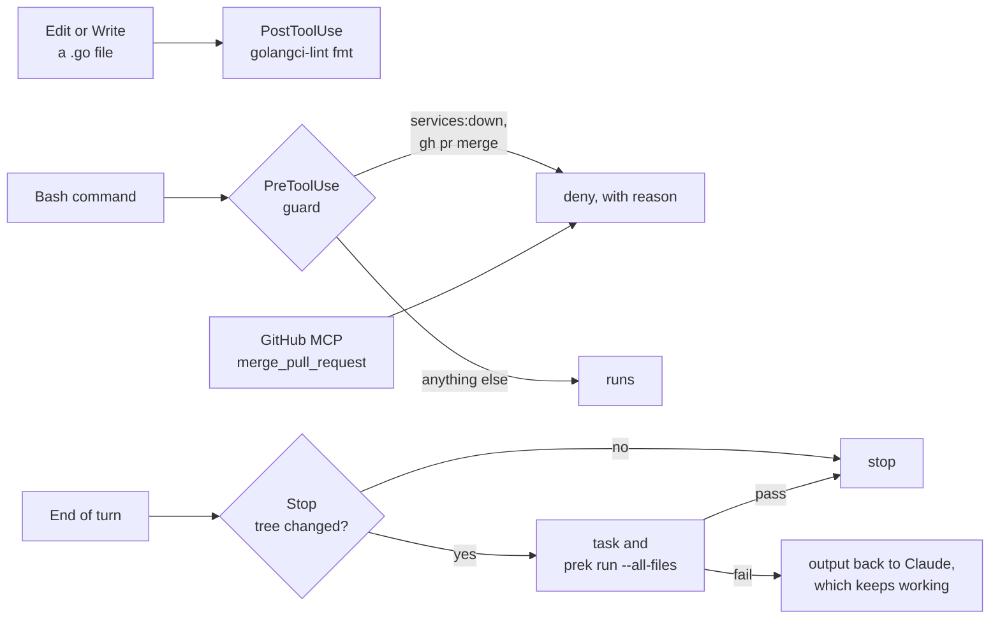
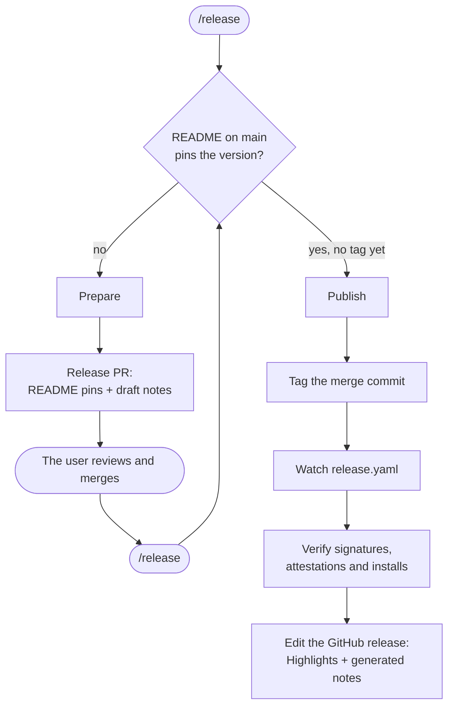

# Turn agent workflow rules into Claude Code hooks

- Status: done
- Issue: [#37](https://github.com/ivanklee86/releash/issues/37), part 3
- Branch: `agent-hooks`

## Goal

The workflow rules that every plan repeats are enforced by Claude Code itself instead of depending on the agent remembering them. The rules are:

- "run `task` and `prek run --all-files` before handing off"
- "never run `task services:down`"
- "Claude never merges"

Releases get a `/release` skill instead of a rule against pushing tags (see [The release skill](#the-release-skill)), so tagging is a step the user starts, not one the agent must remember to avoid.

The configuration is committed, so it travels with the repository and not only in `~/.claude`. `AGENTS.md` becomes `CLAUDE.md`.

## Current state

- `.claude/` exists but is empty, and nothing in it is committed. User-level `~/.claude/settings.json` has no hooks for this repository.
- The plans name `/ship` (commit, push, open the pull request and watch it) and `/code-review`. Both are skills built into Claude Code, not files in any repository, so there is nothing to commit for them (see decision 4).
- `jq` 1.7 is in the devcontainer, so hook scripts can read their JSON input with it.
- `task` takes about 2 seconds when Go's test cache is warm, and about a minute from cold.

## Design

All hook scripts live in `.claude/hooks/`, are plain `bash` with `set -euo pipefail`, read the hook's JSON from stdin with `jq`, and are referenced from `.claude/settings.json` through `"$CLAUDE_PROJECT_DIR"`, so they work from any working directory.

### Format Go files after edits

A `PostToolUse` hook on `Edit|Write|MultiEdit` reads `tool_input.file_path`, and when it ends in `.go`, runs `golangci-lint fmt` on that file. It never blocks: a formatting failure, such as a syntax error, is reported back as context and the Stop hook catches anything still wrong.

### Block or confirm risky commands

A `PreToolUse` hook on `Bash` checks the command, splitting compound commands on `;`, `&&`, `||` and `|` so a rule cannot be dodged by chaining:

| Command | Decision | Why |
|---|---|---|
| `task services:down`, `docker compose down` | deny | The local stack is shared; deleting it breaks other sessions' integration runs. |
| `gh pr merge`, `gh api` calls to a pull request's `merge` endpoint | deny | The user's merge is the checkpoint before dependent work. |

A second `PreToolUse` entry denies `mcp__claude_ai_Github_MCP__merge_pull_request`. `.claude/settings.json` also carries the same denials as `permissions.deny` rules, so they hold even if hooks are turned off.

The hook is a guardrail against mistakes, not a security boundary: a command built at run time (for example through `eval`) can get past it.

### Check the tree at the end of a turn

A `Stop` hook runs `task` and then `prek run --all-files`. When either fails, it exits 2 with the tail of the failing output on stderr, which Claude Code passes back so Claude keeps working on the failure.

- It skips the run when nothing changed since the last passing run. It hashes `git status --porcelain` and `git diff HEAD` and compares that with a stamp in `.git/claude-stop-check`. That keeps turns that only answer a question instant.
- When `stop_hook_active` is set, Claude is already continuing because of this hook. If the checks fail again, the hook reports the failure and lets the turn end instead of blocking a second time, so a failure Claude cannot fix (a missing tool, a down network) cannot loop.
- Timeout 600 seconds, since a cold `task` takes about a minute.
- Integration tests are left out, because they need the stack and take over a minute (see decision 3).

### Settings and ignores

- `.claude/settings.json`: the hooks and the `permissions.deny` rules above. Nothing user-specific: no model, theme or allow-list.
- `.gitignore` gains `.claude/settings.local.json`, for personal overrides.

### Testing the hooks

Each script gets a small test in `.claude/hooks/test.sh` that pipes sample hook JSON into it and checks the exit code and decision. It covers:

- each denied and asked command, also inside a compound command
- harmless look-alikes that must pass, such as `gh pr view`, `docker compose ps` and `task services`
- a `.go` and a non-`.go` edit
- a Stop run with no changes, one with a failing check, and one with `stop_hook_active` set

A `task claude:test-hooks` task runs it, and prek runs it when anything under `.claude/hooks/` changes. The scripts also pass `shellcheck`, run through its prek hook pinned by tag.

### The release skill

`/release [version]` in `.claude/skills/release/SKILL.md` turns the steps the M5 and M6 plans did by hand into one repeatable procedure.

Frontmatter:

- `model: fable`, so every `/release` turn runs on Fable. The skills docs say `model` takes the values `/model` accepts; the first run checks that `fable` is one, and otherwise uses the full ID `claude-fable-5-2`.
- `disable-model-invocation: true`, so only the user can start a release.
- `allowed-tools` for the commands it runs: `git`, `gh`, `docker` (for cosign and the image checks), `curl`, `sha256sum`, `go`.

The skill runs inline, not in a forked subagent, because it talks to the user between steps. `main` takes changes only through pull requests and Claude never merges, so a release takes two runs of `/release`. Each run works out where the release stands from the repository, so running it again always picks up at the right step:

Prepare:

1. Check that the working tree is clean, `main` is up to date, and CI passed on `main`'s head.
2. Pick the version. Without an argument, propose one from the pull requests merged since the last tag and their labels, following spec 0002: `breaking-change` bumps the minor version before `v1.0.0`, `enhancement` bumps the minor version, anything else the patch version. The user confirms or changes it.
3. Draft the notes. Preview GitHub's generated list with the `releases/generate-notes` API. Write a "Highlights" section above it, in the style of `v0.2.0`'s: what changed for users, a short example where it helps, and what stays the same. Flag any pull request whose title would read badly in the notes, or that looks like a contract change without the `breaking-change` label.
4. Update the version pins in `README.md`: the `VERSION=` lines, `go install ...@v<version>`, the image tag and `RELEASH_VERSION`. Leave minimum-version statements such as "`variant` needs releash 0.2.0 or later" alone.
5. Open a pull request titled "Release v\<version\>" with the README change and the draft notes in its description, so the user reviews both in one place before merging. Then stop.

Publish (on the next `/release`, once that pull request is merged):

1. Check that `main`'s head is the merge of the release pull request, that CI passed on it, and that the tag does not exist yet. Running `/release` again after the merge is the user's go to publish.
2. Create the annotated tag `v<version>` on that commit and push it.
3. Find the `release.yaml` run for the tag and watch it to the end, reporting each step that fails. On a failure, stop and explain: the workflow cannot be re-run, and the fix is a new version (see "Release pipeline" in `docs/architecture.md`).
4. Verify from a clean temporary directory, with spec 0002's commands:
   - `cosign verify-blob` on `checksums.txt` and `sha256sum --check` on the linux/amd64 archive
   - `cosign verify` and `cosign verify-attestation --type spdxjson` on the image index and both platform digests
   - the binary and the image report the version
   - `go install` through proxy.golang.org reports `v<version>`
   - for a non-prerelease, the cask in `ivanklee86/homebrew-tap` is at the version and its hashes match `checksums.txt`

   cosign runs from its image, pinned to the workflow's `COSIGN_VERSION`, because the devcontainer does not install it.
5. Edit the GitHub release with `gh release edit --notes-file`: the Highlights from the merged pull request's description above the notes GitHub generated.
6. Report: the release URL, the tag's commit, and the result of each verification.

Spec 0002's "Release notes" says nothing is written by hand at release time. It is amended to say that the notes are GitHub's generated list with a Highlights section above it, written by `/release` and reviewed in the release pull request. `docs/architecture.md` "Release pipeline" points at the skill.

### Rename `AGENTS.md` to `CLAUDE.md`, and trim it

The repository is worked on with Claude Code only, so the instructions file becomes `CLAUDE.md`, which Claude Code loads natively (decision 1). `git mv` keeps its history.

- Update the live references: the comments in `.golangci.yml` and `.markdownlint-cli2.yaml`, and the plans still in progress (`2026-11-28-guardrails.md` and this one). Finished plans and milestones keep saying `AGENTS.md` as history.
- Keep what no check can enforce: the documentation layout, the comment style, the testing philosophy, and the links to the Go style guides and module layout.
- Remove the line "Enforce style with `golangci-lint` ...", which `.golangci.yml` now does.
- Add no workflow rules: the hooks enforce them, and `docs/architecture.md` describes the hooks.

### Docs

`docs/architecture.md` gains a short "Agent workflow" section: what each hook does, and where its script is. Future plans can drop the repeated rules and point there.

## Decisions

1. Decided: `AGENTS.md` is renamed to `CLAUDE.md`, and the workflow rules live only in the hooks.
2. Decided: no rule against pushing tags; releases go through `/release`, which the user starts.
3. Decided: integration tests stay out of the Stop hook: they need the shared stack and take over a minute, so they would slow every turn that touches code. Plans keep listing them as a hand-off check.
4. Decided: the `/ship` and review checklist item is dropped, because both are built into Claude Code; the pull request says so, and no repository commands shadow them. `/release` is the one repository skill this plan adds.

## Verification

- `task claude:test-hooks`, `task` and `prek run --all-files` pass.
- `/release` is first used for the next real release, and that run is checked against the steps above. Until then, its prepare phase is tried once with a made-up version and the pull request closed unmerged.
- In a live session: editing a badly formatted `.go` file leaves it formatted; `task services:down` and `gh pr merge` are refused with the reason; a turn that breaks a test does not end until it is fixed.
