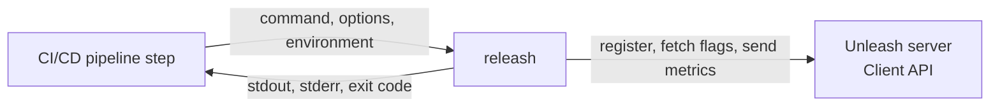
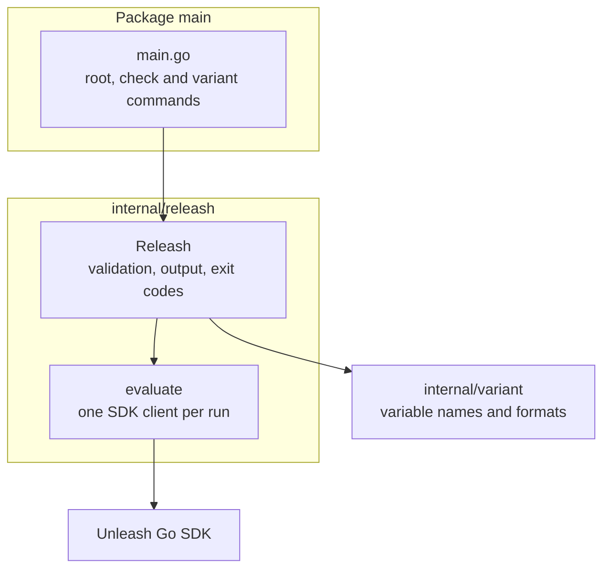
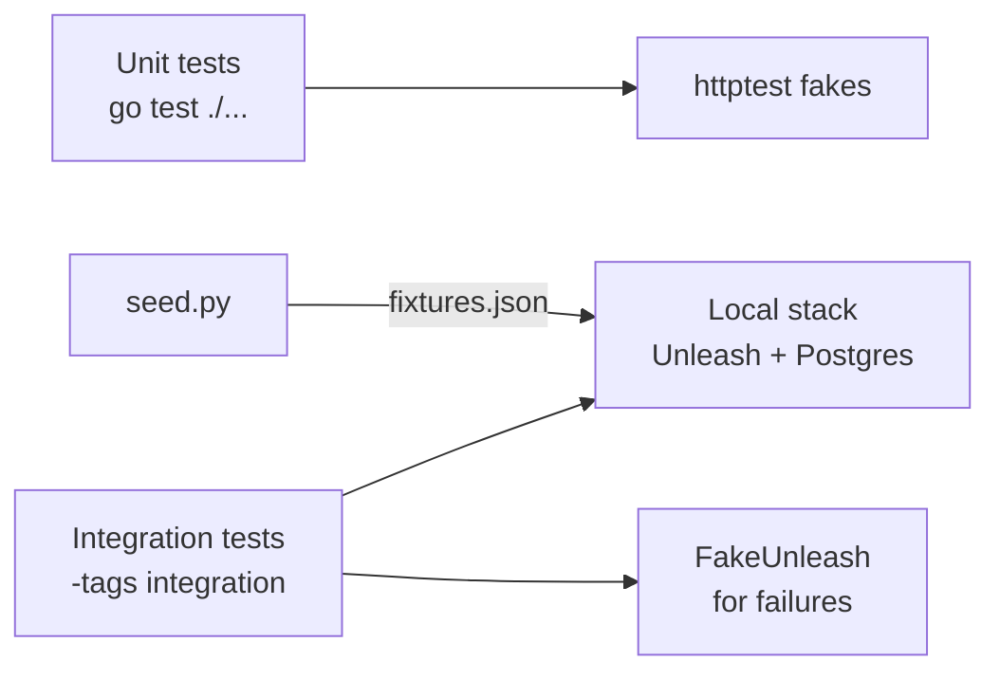
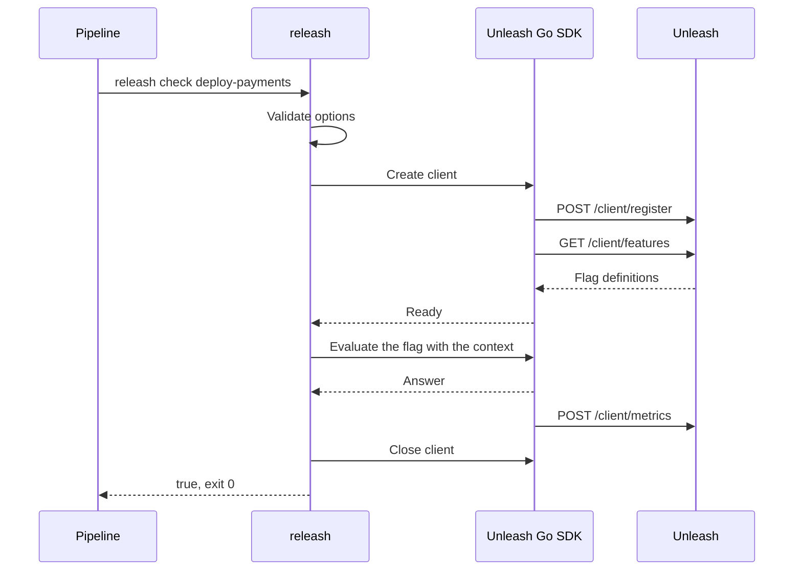
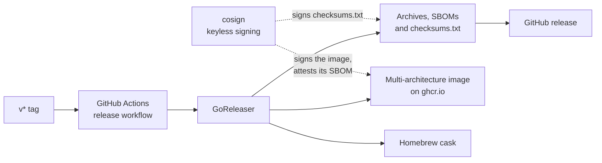

# Architecture

releash is a single, short-lived Go binary. Each run asks Unleash one question about one feature flag, prints the answer and exits. It keeps no state between runs and never writes to Unleash.

## Context

A pipeline step runs releash, which evaluates the flag locally with the Unleash Go SDK after fetching the flag definitions from the Unleash Client API.

The pipeline's contract with releash is stdout and the exit code. stdout holds only the answer (`true` or `false` for `check`, environment variables for `variant`), and every explanation goes to stderr.

## Components

| Component | Responsibility |
|---|---|
| Package `main` | Command-line wiring only. It maps options and environment variables to plain option structs and is the only place that calls `os.Exit`. |
| `internal/releash` | The orchestrator. `Releash.Check` and `Releash.Variant` validate the options, evaluate the flag, write the answer and return an exit code. |
| `internal/variant` | Pure formatting. It turns an evaluated variant into `dotenv` or `shell` lines and has no network or CLI code. |
| Unleash Go SDK | Fetches flag definitions and evaluates strategies, constraints, segments and variants, exactly as an application using Unleash would. |

Commands return exit codes instead of exiting, and write to swappable writers, so tests drive the whole CLI in-process.

## Code layout

The module is `github.com/ivanklee86/releash`, laid out per [Organizing a Go module](https://go.dev/doc/modules/layout). `main.go` sits at the module root so that `go install github.com/ivanklee86/releash@<version>` works.

| Path | What it holds |
|---|---|
| `main.go` | The only non-test Go file in the root: the cobra commands, the option definitions `check` and `variant` share, binding of environment variables, version resolution, and `run`, the one place that maps errors to exit codes. |
| `internal/releash/` | The orchestrator: `Releash`, the exit codes of [ADR 0004](adrs/0004-exit-code-contract.md), validation of `check` and `variant` options, evaluation through the Unleash Go SDK (`evaluate.go`), waiting for usage metrics (`metrics.go`) and the automatic `remoteAddress` (`remoteaddress.go`). |
| `internal/variant/` | The variable names and output formats of [spec 0003](specs/0003-variant-variables.md), with no network or CLI code. |
| `internal/integration/` | Helpers for the integration tests, and the smoke test that checks the seeded fixtures. |
| `unleash/` | `fixtures.json`, the flags the local stack is seeded with, and `seed.py`, which reconciles Unleash with them through the Admin API. |
| `docker-compose.yaml`, `.env.example` | The local Unleash stack and the dev-only settings for running `bin/releash` against it. |
| `Taskfile.yaml`, `tasks/` | Developer and CI tasks. `task --list` describes each. |
| `.goreleaser.yaml`, `Dockerfile`, `.github/release.yml` | The release build, the release image and the release notes categories. |
| `.github/workflows/`, `.github/actions/` | CI, the release workflow, and composite actions that install pinned Task and syft. |
| `.golangci.yml`, `.pre-commit-config.yaml`, `.markdownlint-cli2.yaml`, `renovate.json` | Lint, prek hooks and Renovate. Each file comments its non-obvious settings. |
| `.devcontainer/` | Generated by gantry from the `ivanklee86/devcontainers` Go base. Regenerate with `gantry build --config gantry.yaml --write` in that folder. |
| `.claude/` | Claude Code settings shared by everyone working on the repository: the hooks in `hooks/` and the `/release` skill in `skills/release/` (see [Agent workflow](#agent-workflow)). |

## Tests

There are two kinds of test.

- Unit tests are plain `_test.go` files and need neither Docker nor network access. Tests that need an Unleash use `httptest` fakes. `task go:test` runs them.
- Integration tests start with `//go:build integration` and run on the host against the local stack. `task services` starts and seeds it, and `task go:test-integration` runs both kinds. To run one scenario, pass `-run` with the tag, e.g. `go test -tags integration -count=1 -run TestClientTokensSeeTheFixtureFlags ./internal/integration/`.

Integration scenarios are named after how a pipeline uses releash, e.g. `TestDeployGateStaysClosedWhenTokenIsRejected`. A scenario that needs a flag the fixtures do not hold creates one with `integration.CreateFlag` or `CreateVariantFlag`, which archive it when the test ends. Failures the stack cannot produce on demand, such as a 403 or a hanging metrics endpoint, use `integration.FakeUnleash`. Anything the Unleash Admin API refuses to store, such as invalid JSON payloads, is covered by unit tests only.

## Local development

`docker-compose.yaml` runs Postgres, the Unleash server on `localhost:4242`, and a one-shot `seed` service. Its tokens are fixed, dev-only values and are not secrets. Open-source Unleash has only the `default` project, so there is no fixture for a flag a client token cannot see.

- `task services` starts the stack and seeds it; it is safe to run on a running stack.
- `task services:down` deletes the stack and its data. Use it after removing or renaming a fixture, because the seed never deletes flags.
- `task releash -- check enabled-everywhere --loud` builds and runs releash against the stack with the production client token.

`UNLEASH_URL` is releash's setting and includes `/api`; `UNLEASH_SERVER_URL` is the seed's and is the server root.

The README and specs use `deploy-payments` only as an example; it is not seeded. Against the local stack, use a flag from `unleash/fixtures.json`, such as `enabled-everywhere`.

## CI

`.github/workflows/ci.yaml` runs on pull requests and on pushes to `main`.

| Job | What it checks |
|---|---|
| `lint` | Formatting, `golangci-lint`, the build, and a tidy `go.mod`. |
| `test` | Unit tests. |
| `pre-commit` | The prek hooks, except those `lint` already covers. They include actionlint and zizmor (offline audits) on the workflows; `.github/actionlint.yaml` and `.github/zizmor.yml` hold their settings. |
| `integration` | Unit and integration tests against the compose stack, with a JUnit check run and an octocov coverage comment. It fails when coverage drops below 95% or falls by more than one point against `main` (`.octocov.yml`). It is the only job with write permissions. |
| `release-check` | A snapshot of the full release build, without signing or pushing, smoke-tested with `--version`. |
| `release-notes` | That `.github/release.yml` matches the categories in spec 0002. |

The `main` ruleset is configured in GitHub, not in the repository. It requires a pull request for every change, with no required approvals, and requires `lint`, `test`, `pre-commit` and `integration` to pass. `release-check` and `release-notes` are deliberately not required. Renovate automerges through GitHub's native auto-merge, so it waits only for the required checks; this is why updates that only `release-check` exercises are in Renovate's `release` group, which never automerges.

Every third-party action is pinned to a full commit SHA with its tag in a trailing comment, so a moved tag cannot change what CI runs. To bump one by hand, resolve the new tag to its commit SHA, dereferencing annotated tags, and update both the SHA and the comment.

## A run

`check` and `variant` share every step below and differ only in the question they ask the SDK.

- One deadline, `--timeout`, bounds the whole run, including every request.
- The SDK is designed for long-running services, so releash replaces several of its defaults. Flags are held in memory only, there is no background refresh, and releash waits for the usage metrics to be sent before it exits.
- When `--remote-address` is not given, releash uses the local address of its connection to Unleash as `remoteAddress` in the context.

## Outcomes

releash fails safe. A problem with Unleash never turns a gate on and never fails the pipeline, while a mistake in the command always fails it.

The fallback answer is `false` for `check` and the disabled variant for `variant`, except that `variant` prints nothing on exit 2, a bad command line ([ADR 0008](adrs/0008-leave-command-line-parsing-to-cobra.md)). `--loud` explains a fallback on stderr. A flag that Unleash does not know is explained without `--loud` too, because it is usually a typo ([ADR 0009](adrs/0009-report-unknown-flag-without-loud.md)). An internal error in releash, such as a recovered panic, also prints the fallback answer and exits 1.

## Release pipeline

Pushing a `v*` tag runs the release workflow, which builds, signs and publishes every artifact.

Signatures are tied to the workflow's identity through GitHub's OIDC token, so there are no signing keys to manage or leak. That identity includes the path of `.github/workflows/release.yaml`, so renaming the workflow is a breaking change.

The workflow runs in this order:

1. For a tag without a prerelease suffix, check that the Homebrew tap token can push, before anything is published. goreleaser pushes the cask last, so a bad token would otherwise leave a half-published release.
2. Run goreleaser, which publishes and signs the archives, checksums and image, and pushes the cask.
3. Generate an SPDX SBOM for each platform image with syft and attach it with `cosign attest`. This runs even if goreleaser failed late, because the image may already be public.
4. Download what was published and verify it exactly as spec 0002 tells users to.

A failure in step 3 or 4 leaves a published release that is missing an attestation or does not verify. Re-running the job does not fix it, because goreleaser would run against assets that already exist. Fix the cause and tag the next version instead. To check a release change locally, run `task release:check`, `task release:snapshot` and `task release:smoke-test`.

Releases are cut with the `/release` Claude Code skill. Its first run opens a "Release v\<version\>" pull request that pins the README to the new version and carries draft Highlights for the notes. After the user merges it, a second run tags the merge commit, watches the workflow, verifies the signatures, attestations and installs as users would, and puts the Highlights above the generated notes.

## Agent workflow

`.claude/settings.json` sets up hooks that enforce the repository's workflow rules in Claude Code, so they do not depend on the agent remembering them. The scripts are in `.claude/hooks/`, and `task claude:test-hooks` tests them; CI runs that in the `lint` job.

| Hook | Script | What it does |
|---|---|---|
| After `Edit`, `Write` or `MultiEdit` | `format-go.sh` | Formats an edited `.go` file with `golangci-lint fmt`. It never blocks, and reports a file it cannot format. |
| Before `Bash` and the GitHub MCP merge tool | `guard.sh` | Refuses `task services:down`, `docker compose down`, `docker compose rm` with volumes and `docker volume rm` or `prune`, which delete the shared local stack or its data, and merging a pull request, which only the user does. Compound commands, subshells and `bash -c` payloads are checked piece by piece. |
| End of a turn | `stop-check.sh` | When the tree changed since the last pass, runs `task` and `prek run --all-files`, and sends a failure back so Claude fixes it. A second failure in a row is reported without blocking, so it cannot loop. |

The same refusals are also `permissions.deny` rules, so they hold with hooks turned off. The hooks guard against mistakes; they are not a security boundary. Integration tests are not run at the end of a turn, because they need the shared stack and take over a minute. Personal overrides go in `.claude/settings.local.json`, which git ignores.

## Key technology

| Area | Technology |
|---|---|
| Language | [Go](https://go.dev/), built as a static binary without cgo |
| Command line | [Cobra](https://github.com/spf13/cobra) for commands and options, [Viper](https://github.com/spf13/viper) for environment variables |
| Flag evaluation | [Unleash Go SDK](https://docs.getunleash.io/sdks/go) |
| Tests | [Testify](https://github.com/stretchr/testify), with integration tests against a local Unleash and Postgres in Docker Compose |
| Linting | [golangci-lint](https://golangci-lint.run/), [markdownlint](https://github.com/DavidAnson/markdownlint-cli2) and [prek](https://github.com/j178/prek) hooks |
| Task runner | [Task](https://taskfile.dev/) |
| CI | [GitHub Actions](https://docs.github.com/en/actions) |
| Release build | [GoReleaser](https://goreleaser.com/) |
| Supply chain | [cosign](https://docs.sigstore.dev/cosign/) keyless signing, [syft](https://github.com/anchore/syft) SPDX SBOMs |
| Container image | [Distroless](https://github.com/GoogleContainerTools/distroless) static base, running as non-root |
| Dependency updates | [Renovate](https://docs.renovatebot.com/), with every version pinned |

## Key decisions

| Decision | Record |
|---|---|
| releash only reads from Unleash | [ADR 0001](adrs/0001-read-only-by-design.md) |
| It uses the Client API, not the Frontend API | [ADR 0002](adrs/0002-client-api-over-frontend-api.md) |
| It answers `false` when Unleash cannot answer | [ADR 0003](adrs/0003-fail-safe-false.md) |
| Exit codes are a stable contract | [ADR 0004](adrs/0004-exit-code-contract.md) |
| Releases use cosign keyless signing | [ADR 0005](adrs/0005-cosign-keyless-signing.md) |
| Variant variable names follow fixed rules | [ADR 0006](adrs/0006-variant-variable-names.md) |
| `variant` refuses a disabled flag | [ADR 0007](adrs/0007-refuse-variant-of-disabled-flag.md) |
| cobra alone parses the command line, and `variant` prints nothing on exit 2 | [ADR 0008](adrs/0008-leave-command-line-parsing-to-cobra.md) |
| An unknown flag is reported without `--loud` | [ADR 0009](adrs/0009-report-unknown-flag-without-loud.md) |
