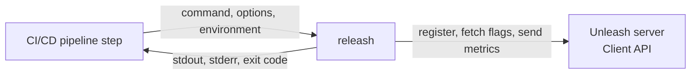
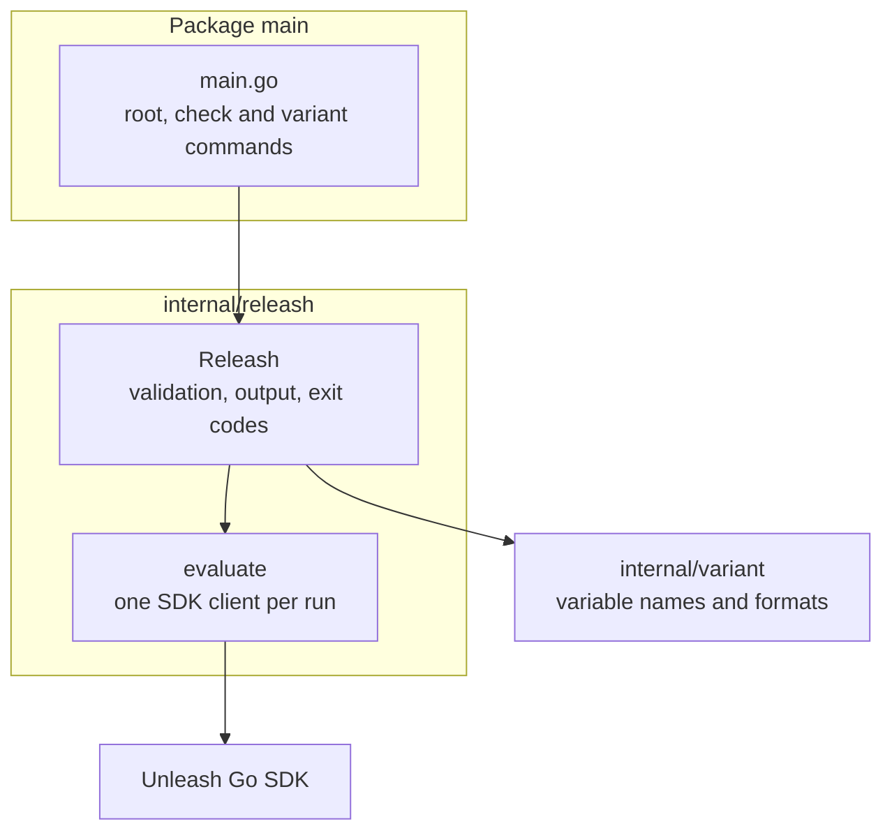
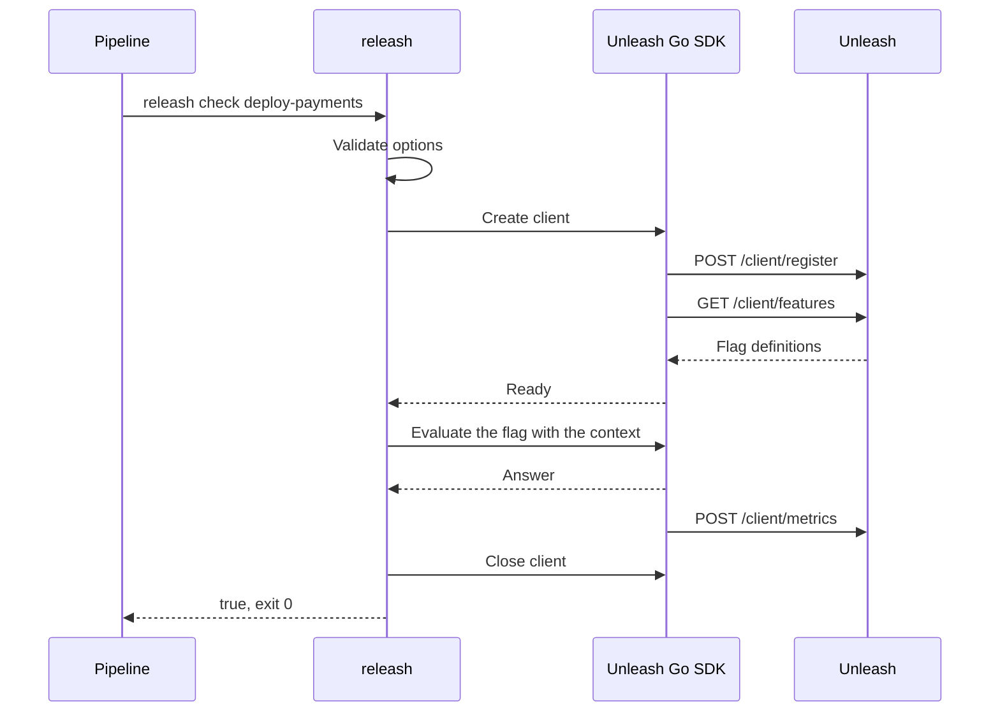
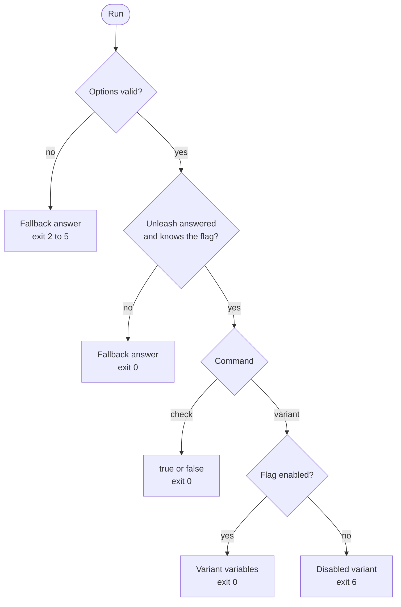
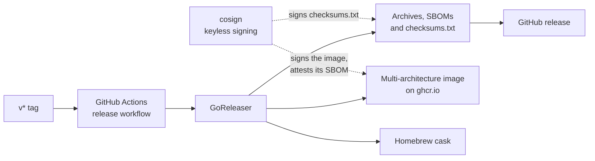

# Architecture

releash is a single, short-lived Go binary. Each run asks Unleash one question about one feature flag, prints the answer and exits. It keeps no state between runs and never writes to Unleash.

## Context

A pipeline step runs releash, which evaluates the flag locally with the Unleash Go SDK after fetching the flag definitions from the Unleash Client API.

The pipeline's contract with releash is stdout and the exit code. stdout holds only the answer (`true` or `false` for `check`, environment variables for `variant`), and every explanation goes to stderr.

## Components

| Component | Responsibility |
|---|---|
| Package `main` | Command-line wiring only. It maps options and environment variables to plain option structs and is the only place that calls `os.Exit`. |
| `internal/releash` | The orchestrator. `Releash.Check` and `Releash.Variant` validate the options, evaluate the flag, write the answer and return an exit code. |
| `internal/variant` | Pure formatting. It turns an evaluated variant into `dotenv` or `shell` lines and has no network or CLI code. |
| Unleash Go SDK | Fetches flag definitions and evaluates strategies, constraints, segments and variants, exactly as an application using Unleash would. |

Commands return exit codes instead of exiting, and write to swappable writers, so tests drive the whole CLI in-process.

## A run

`check` and `variant` share every step below and differ only in the question they ask the SDK.

- One deadline, `--timeout`, bounds the whole run, including every request.
- The SDK is designed for long-running services, so releash replaces several of its defaults. Flags are held in memory only, there is no background refresh, and releash waits for the usage metrics to be sent before it exits.
- When `--remote-address` is not given, releash uses the local address of its connection to Unleash as `remoteAddress` in the context.

## Outcomes

releash fails safe. A problem with Unleash never turns a gate on and never fails the pipeline, while a mistake in the command always fails it.

The fallback answer is `false` for `check` and the disabled variant for `variant`, except that `variant` prints nothing on exit 2, a bad command line ([ADR 0008](adrs/0008-leave-command-line-parsing-to-cobra.md)). `--loud` explains a fallback on stderr. A flag that Unleash does not know is explained without `--loud` too, because it is usually a typo ([ADR 0009](adrs/0009-report-unknown-flag-without-loud.md)). An internal error in releash, such as a recovered panic, also prints the fallback answer and exits 1.

## Release pipeline

Pushing a `v*` tag runs the release workflow, which builds, signs and publishes every artifact.

Signatures are tied to the workflow's identity through GitHub's OIDC token, so there are no signing keys to manage or leak.

## Key technology

| Area | Technology |
|---|---|
| Language | [Go](https://go.dev/), built as a static binary without cgo |
| Command line | [Cobra](https://github.com/spf13/cobra) for commands and options, [Viper](https://github.com/spf13/viper) for environment variables |
| Flag evaluation | [Unleash Go SDK](https://docs.getunleash.io/sdks/go) |
| Tests | [Testify](https://github.com/stretchr/testify), with integration tests against a local Unleash and Postgres in Docker Compose |
| Linting | [golangci-lint](https://golangci-lint.run/), [markdownlint](https://github.com/DavidAnson/markdownlint-cli2) and [prek](https://github.com/j178/prek) hooks |
| Task runner | [Task](https://taskfile.dev/) |
| CI | [GitHub Actions](https://docs.github.com/en/actions) |
| Release build | [GoReleaser](https://goreleaser.com/) |
| Supply chain | [cosign](https://docs.sigstore.dev/cosign/) keyless signing, [syft](https://github.com/anchore/syft) SPDX SBOMs |
| Container image | [Distroless](https://github.com/GoogleContainerTools/distroless) static base, running as non-root |
| Dependency updates | [Renovate](https://docs.renovatebot.com/), with every version pinned |

## Key decisions

| Decision | Record |
|---|---|
| releash only reads from Unleash | [ADR 0001](adrs/0001-read-only-by-design.md) |
| It uses the Client API, not the Frontend API | [ADR 0002](adrs/0002-client-api-over-frontend-api.md) |
| It answers `false` when Unleash cannot answer | [ADR 0003](adrs/0003-fail-safe-false.md) |
| Exit codes are a stable contract | [ADR 0004](adrs/0004-exit-code-contract.md) |
| Releases use cosign keyless signing | [ADR 0005](adrs/0005-cosign-keyless-signing.md) |
| Variant variable names follow fixed rules | [ADR 0006](adrs/0006-variant-variable-names.md) |
| `variant` refuses a disabled flag | [ADR 0007](adrs/0007-refuse-variant-of-disabled-flag.md) |
| cobra alone parses the command line, and `variant` prints nothing on exit 2 | [ADR 0008](adrs/0008-leave-command-line-parsing-to-cobra.md) |
| An unknown flag is reported without `--loud` | [ADR 0009](adrs/0009-report-unknown-flag-without-loud.md) |
